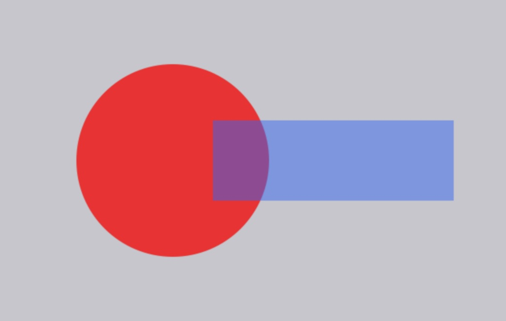
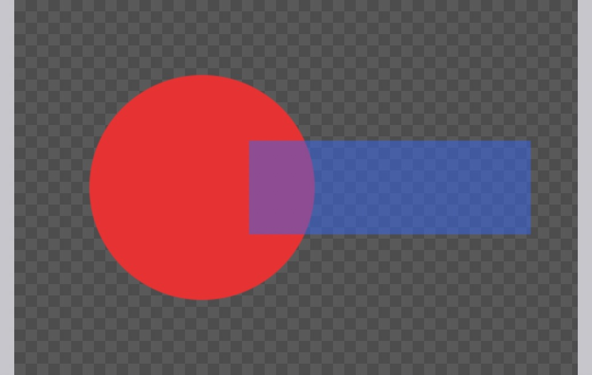

## Description

<!-- SECTION:DESCRIPTION:BEGIN -->
Export As previews the encoded file on the pasteboard color, so transparent areas look the same as the margin around the image and Transparency on or off is hard to judge. Photoshop's Export As shows transparency on a checkerboard. Upstream b1db93d draws the canvas checkerboard behind the preview; Lamina's FilterPreview already draws one (its fixed colors are allowed by DESIGN.md's Colors and surfaces), which can be shared.
<!-- SECTION:DESCRIPTION:END -->

## Acceptance Criteria
<!-- AC:BEGIN -->
- [x] #1 Export As draws the canvas checkerboard behind the image only (not the margin), at every zoom, so transparent pixels read as transparent
- [x] #2 The filter preview and Export As share one checkerboard drawing, and DESIGN.md's Export As entry says it
<!-- AC:END -->

## Implementation Plan

<!-- SECTION:PLAN:BEGIN -->
1. Add UI/Checkerboard.swift: the canvas's 20-pt tile (10-pt squares, 0.35/0.30 grays, light square top-left) as one SwiftUI Image, with a tiled view for backgrounds.
2. FilterPreview fills the layer area with that tile (.tiledImage from the layer's corner) instead of building a path of squares.
3. ExportPreview puts the tiled checkerboard behind the image only, in Fit and zoomed modes (background of the image frame, so the margin stays pasteboard), as upstream b1db93d.
4. DESIGN.md Export As entry says it; test that the tile's pixels match the canvas colors; swift build + swift test; dev build screenshot of Export As on a transparent document if it can be opened unattended.
<!-- SECTION:PLAN:END -->

## Implementation Notes

<!-- SECTION:NOTES:BEGIN -->
- `UI/Checkerboard.swift`: the canvas's checkerboard as one 20-pt tile (10-pt squares, 0.35 / 0.30 gray, lighter top-left, as `EditorCanvas` draws it), filled into a GraphicsContext (`Checkerboard.fill`, from the layer's corner) or tiled as a view (`Checkerboard.view`). The tile costs the same at any zoom, unlike a path of squares the size of a zoomed export.
- FilterPreview fills the layer area with the tile instead of building a path of squares; ExportPreview puts `Checkerboard.view` as the background of the image's own frame in Fit and zoomed modes (as upstream b1db93d), so the margin stays `pasteboard`.
- Evidence: `CheckerboardTests` (the tile's pixels); offscreen renders of `ExportPreview` with a synthetic transparent 600 × 400 image at Fit, 25% (checkerboard only behind the small image, margin pasteboard) and 200% (in an NSHostingView, scroll view included); `swift build` and `swift test` (835 tests) pass. Export As itself can't be opened unattended (menu or ⌥⇧⌘W), so scrolling while zoomed was not watched live.
- README/website: none needed; a small preview polish with no new feature or marketing screenshot.
- Gotcha: a gray 1-channel `NSBitmapImageRep` as an `NSGraphicsContext` raises an Objective-C exception that the test host's run loop swallows, so the test hangs instead of failing.

Before (image on the pasteboard color) and after (Fit), synthetic image:

<!-- SECTION:NOTES:END -->

## Final Summary

<!-- SECTION:FINAL_SUMMARY:BEGIN -->
Export As now previews transparent areas on the canvas's checkerboard, behind the image only and at every zoom; the filter preview draws the same shared tile (`Checkerboard`). DESIGN.md's Export As entry says so. Verified with a tile pixel test, offscreen renders at Fit, 25% and 200%, and the full test suite.
<!-- SECTION:FINAL_SUMMARY:END -->
