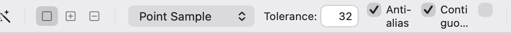
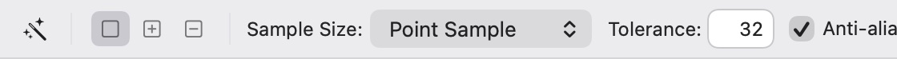

## Description

<!-- SECTION:DESCRIPTION:BEGIN -->
OptionsBarRow (UI/OptionsBar.swift) and MoveToolBar lay their controls out in a fixed row, so in a window narrower than the bar (the window can be 800 pt wide) controls squeeze or clip. FreeTransformBar already scrolls horizontally with hidden indicators and keeps Cancel and Commit pinned outside the scroll. Upstream 68396ff (Stv.X, from PR #226) did this per tool header; in Lamina one change in OptionsBarRow covers every bar.
<!-- SECTION:DESCRIPTION:END -->

## Acceptance Criteria
<!-- AC:BEGIN -->
- [x] #1 Every options bar keeps its controls at full size and scrolls horizontally, without a scroller, when the window is too narrow for it
- [x] #2 Cancel and Commit stay visible at the bar's right end while an edit is pending
- [x] #3 At 1500 × 860 pt nothing scrolls, and DESIGN.md's Options bars section says the rule
<!-- AC:END -->

## Implementation Plan

<!-- SECTION:PLAN:BEGIN -->
1. OptionsBarRow: put the controls in a horizontal ScrollView with hidden indicators and bounce only when the bar overflows; keep the commit buttons outside it at the right end (as FreeTransformBar does).
2. MoveToolBar: build on OptionsBarRow instead of its own HStack, so it scrolls too.
3. Test: render OptionsBarRow offscreen at a narrow and a wide width and check the controls keep their size and Cancel/Commit stay inside the bar; check the widest bar (Magic Wand, Type) fits the 1500 pt window's options bar width.
4. DESIGN.md Options bars: state the rule.
<!-- SECTION:PLAN:END -->

## Implementation Notes

<!-- SECTION:NOTES:BEGIN -->
- `OptionsBarRow` puts a bar's controls in a horizontal `ScrollView` (indicators hidden, bounce only when it overflows); Cancel and Commit sit outside it at the right end. `MoveToolBar` now builds on `OptionsBarRow`, so every bar but Free Transform (which already scrolled; it gained the same bounce rule) goes through one place.
- The tool → bar switch moved out of `ContentView` into `ToolSettings` (UI/OptionsBar.swift) so tests can lay out each tool's bar.
- Evidence: `OptionsBarTests.aNarrowBarScrollsAndKeepsCommitInView` (a 900 pt setting keeps its width in a 400 pt bar, its scroll view's content is wider than the viewport, no horizontal scroller, the scroll view ends 69 pt before the bar's edge, leaving Cancel and Commit in view) and `everyToolFitsAt1500Points` (every tool's bar at 1500 pt: content no wider than the viewport; the widest, Magic Wand, measured about 940 pt). Full `swift test`: 839 tests pass.
- README and website: no change, as this is layout polish with nothing new to show.
- Offscreen renders of the Magic Wand bar at 560 pt wide, light:

- Manual check left for the user: in a narrow Dev window, scroll the Magic Wand bar sideways with the trackpad and check it feels right.
<!-- SECTION:NOTES:END -->

## Final Summary

<!-- SECTION:FINAL_SUMMARY:BEGIN -->
Options bars no longer squeeze in a narrow window: `OptionsBarRow` scrolls its controls sideways without a scroller and keeps Cancel and Commit pinned at the right; the Move bar now uses it too. At 1500 pt nothing scrolls. DESIGN.md's Options bars section states the rule. Tests: `OptionsBarTests` (2 new); full suite passes.
<!-- SECTION:FINAL_SUMMARY:END -->
