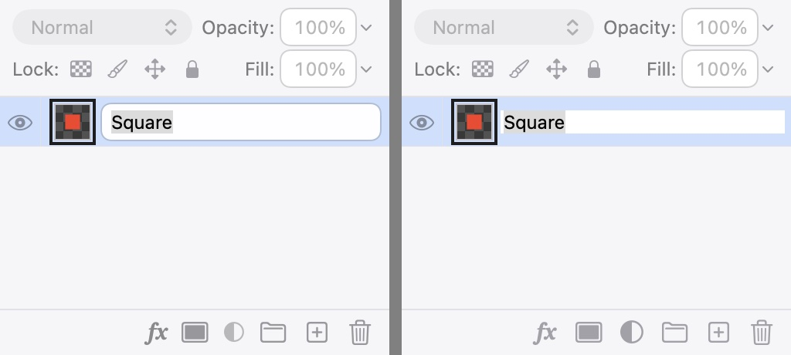
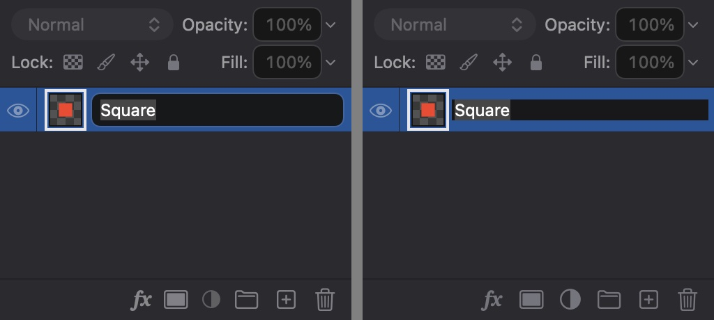

## Description

<!-- SECTION:DESCRIPTION:BEGIN -->
Two Layers panel details from upstream PR #226 (Stv.X) and 790195f. The footer mixes plain buttons and borderless menus whose icons take an explicit ColorRole.icon foreground, which stops SwiftUI dimming them, so disabled footer icons dim unevenly or not at all (also PropertiesFooterButton). And the rename field gets a rounded bezel that changes the row's height and makes it jump (8f7d344 keeps the field's size and marks editing with a background instead). Upstream's colors (Color.white.opacity, quaternaryLabelColor) are literals; Lamina must use its color roles.
<!-- SECTION:DESCRIPTION:END -->

## Acceptance Criteria
<!-- AC:BEGIN -->
- [x] #1 Disabled footer icons in Layers and Properties dim the same way, through a color role, in light and dark
- [x] #2 Renaming a layer keeps the row and its name at the same size and position, marking the field with a color role background
- [x] #3 DESIGN.md's Iconography gets the disabled-icon rule and its Layers section the rename look; screenshots in both appearances
<!-- AC:END -->

## Implementation Plan

<!-- SECTION:PLAN:BEGIN -->
1. Measure how the footer's plain buttons and borderless menus draw enabled and disabled icons (offscreen render, light and dark).
2. One FooterButtonStyle for PropertiesFooterButton, the Add layer mask button and the footer menus (menuStyle(.button)): icon, text while on, tertiaryText when disabled.
3. Rename: drop the rounded bezel, mark the field with a field-role background, and keep the label's alignment insets so the name doesn't move.
4. Tests (FooterIconTests, LayersPanelTests rename), DESIGN.md (Iconography, Layers), before/after screenshots.
<!-- SECTION:PLAN:END -->

## Implementation Notes

<!-- SECTION:NOTES:BEGIN -->
Measured offscreen (throwaway NSHostingView + cacheDisplay test): a .plain button with an explicit color is dimmed by SwiftUI (light A8A8AB, dark 939396) while a .borderlessButton menu ignores the label's color and draws it in the system's (enabled 313131 / E5E5E6, disabled C4C4C6 / 737375). A custom ButtonStyle applies to both buttons and Menus with menuStyle(.button), and SwiftUI adds no dimming of its own, so the footer's icons now take icon, or tertiaryText when disabled, everywhere.

Rename: the bezel made the field taller; dropping it wasn't enough, because an NSTextField label's alignment rect is inset 2 pt either side and an editable one's isn't, so Auto Layout moved the name 2 pt right and 4 pt narrower. LayerNameField keeps the label's insets. The field is marked with ColorRole.field as its background (dynamic, follows the appearance), upstream's quaternaryLabelColor literal not used.

Choices: the History panel's undo/redo footer buttons were left as they are (outside the Layers/Properties scope). No README/website change: polish of existing controls, no new feature.

<!-- SECTION:NOTES:END -->

## Final Summary

<!-- SECTION:FINAL_SUMMARY:BEGIN -->
Disabled icons in the Layers and Properties footers now dim alike to tertiaryText through one FooterButtonStyle, shared by plain buttons and the footer menus (now menuStyle(.button)). Renaming a layer keeps the name's size and position (no bezel; LayerNameField keeps the label's alignment insets) and marks the field with a field-role background. DESIGN.md Iconography and Layers updated; before/after screenshots in light and dark.

Evidence: FooterIconTests (button, mask button and menu draw the same ink enabled and disabled, light and dark; failed before the change), LayersPanelTests.renamingKeepsTheNameWhereItIs (frame, height and editor position unchanged; failed before), swift build and swift test (837 tests) pass. Manual check left: clicking the fx and adjustment footer menus still opens them under the icon (menuStyle(.button) change).
<!-- SECTION:FINAL_SUMMARY:END -->
